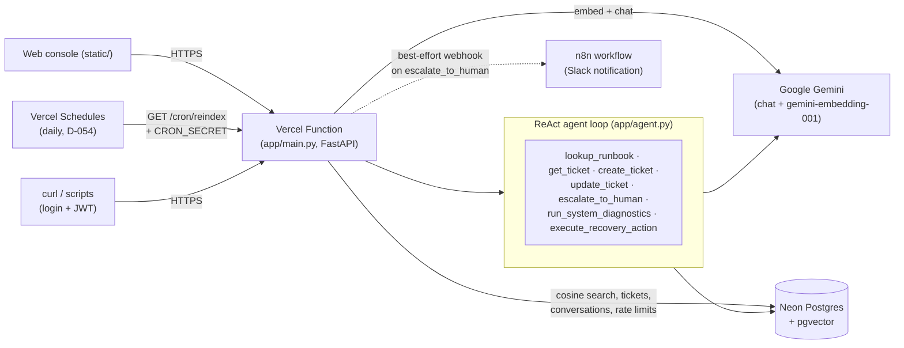

# AI Support & Knowledge Ops Platform (KnowOps AI)

[](https://github.com/vaibhavii2810/KnowOps-AI-/actions/workflows/tests.yml)

An AI-powered technical support backend for DevOps/SRE teams. It answers support questions from a
runbook knowledge base with citations (RAG), and runs an agent that can search the knowledge base,
create, check and triage incident tickets, and escalate to a human.

**Progress:** Phases 1–14 of 15 complete. Live status of every phase: [AGENTS.md](AGENTS.md#phase-status). New to the code? Start with [CODE_TOUR.md](CODE_TOUR.md).

## Architecture

Every request lands on the same FastAPI app, running as one Vercel Function. `/ask` is plain retrieval-augmented
generation; the agent endpoints run a ReAct tool-calling loop on top of the same retrieval and the same Postgres
database. Scheduled re-indexing and manual requests go through the identical route.



Request flow for `/ask`: embed the question → cosine-similarity search over `chunks` in Neon → build a grounded
prompt with the retrieved text fenced as untrusted data (D-034) → one Gemini chat call → answer + ranked citations.
The agent endpoints (`/agent/chat`, `/agent/triage/{id}`) repeat a send→tool-call→observe loop (bounded by
`max_steps`) instead of a single retrieval step. Full call chains for every route are in [FLOW.md](FLOW.md).

## Stack (free tier)

| Layer | Choice |
|---|---|
| Hosting | Vercel (Hobby) |
| Backend | Python + FastAPI |
| Database | Neon Postgres + pgvector |
| LLM + embeddings | Google Gemini (`gemini-embedding-001`, 768 dims) |
| Auth | Self-rolled JWT |
| CRM | Mocked in Postgres |
| Automation | Vercel Cron + local n8n |
| Testing | pytest (offline fakes, no real API calls) + GitHub Actions on every push |
| Monitoring | Structured JSON logs (Vercel Runtime Logs) + `GET /metrics` |

## Quick start

1. `python -m venv .venv` and activate it
2. `pip install -r requirements.txt`
3. Copy `.env.example` to `.env` and fill in real values (never commit `.env`)
4. Run `scripts/init_db.sql` against your Neon database (SQL editor or psql)
5. `python scripts/ingest.py` to load `data/docs/` into the knowledge base
6. `uvicorn app.main:app --reload`, then open `/health`, `/docs` (Swagger) or `/` (web console)

Tests: `pytest` (skips tests marked `live`) · `pytest -m live` (tests that need the real database and Gemini)

Evaluation: `python -m evals` runs 19 golden questions through the real `/ask` and prints accuracy (add `--judge` for a Gemini
second opinion, `--url https://…` to test a deployed site). Each question's time is shown and anything over 5 s is flagged `SLOW`; answers that look unsupported by the retrieved runbook text are flagged too. Every run is saved to `evals/reports/run-<time>.json` (git-ignored; `--report PATH` / `--no-report`), and `--repeat 3` runs the set three times and shows which questions are unstable. It uses real services, so it is separate from `pytest`.

## Project layout

```
app/        FastAPI app: routes, config, DB, auth, RAG, LLM, agent, CRM, retry, guardrails, rate limits, logs, metrics
api/        Vercel entrypoint (sprint-2 branch)
scripts/    DB schema, ingestion
data/docs/  runbook knowledge base
static/     web console
n8n/        n8n workflow export
tests/      pytest suite (offline fakes in conftest.py) + RAG eval
evals/      AI evaluation harness: golden question set and the `python -m evals` runner and its JSON reports (Phase 13)
.github/    CI workflow: runs pytest on every push
```

## API reference

Full interactive docs (Swagger UI) are served at **`/docs`** on any running instance (local or deployed) — every
request/response schema, tried live from the browser. The routes, summarized:

| Method | Path | Auth | Purpose |
|---|---|---|---|
| GET | `/` | none | Web operations console |
| GET | `/health` | none | DB + knowledge-base health |
| GET | `/metrics` | JWT | Request count, average latency, error rate — last 1–168 hours, per route |
| POST | `/auth/login` | none (rate-limited) | Returns a JWT |
| GET | `/auth/me` | JWT | Current operator |
| POST | `/ask` | JWT (rate-limited) | RAG answer with citations |
| POST/GET | `/conversations`, `/conversations/{id}` | JWT | Chat history |
| POST/GET/PATCH | `/tickets`, `/tickets/stats`, `/tickets/{id}` | JWT | Mock CRM |
| POST | `/agent/chat`, `/agent/triage/{ticket_id}` | JWT (rate-limited) | ReAct agent with 7 tools |
| GET | `/cron/reindex` | `CRON_SECRET` bearer | Re-index changed `data/docs/` files |

The full table with exact rate limits and decision references is in [AGENTS.md](AGENTS.md#api).

## Deployment

Deployed on Vercel through the project `knowops-ai-`, which is Git-connected to this repo, so pushes
deploy automatically. Environment variables are set in the Vercel dashboard. Details in
[AGENTS.md](AGENTS.md#deployment).

## Monitoring

Every request writes one JSON log line (request id, user, latency, status, tools the agent used) that shows up in
Vercel's Runtime Logs; the id also comes back in an `X-Request-ID` header. `GET /metrics` (login required) reports
request count, average latency and error rate for the last 1–168 hours, per route. Details in [AGENTS.md](AGENTS.md)
(Phase 12) and [DECISION.md](DECISION.md) (D-042, D-043, D-046).

## Understanding the code

- [FLOW.md](FLOW.md) — entry points, startup order, and which function calls which for every route
- [DECISION.md](DECISION.md) — every meaningful decision and the reason behind it (why this library, why this tradeoff)

## Who built what

[PORTFOLIO.md](PORTFOLIO.md) maps each person's work on this project to concrete, resume-ready skills.

## Team workflow

The build follows a shared 15-phase build guide (ask a teammate for the link). The rules for AI agents live in
[AGENTS.md](AGENTS.md):

- Agents log decisions in `DECISION.md` and keep `FLOW.md` up to date with every code change.
- Before a code change is accepted, the agent **quizzes you with 3 questions about it**. You have to get all 3
  right for the change to count as accepted.
- After finishing a phase, run **`/phase-done <phase>`** in Antigravity or Claude Code. It updates the status
  table, phase log and known issues in `AGENTS.md` and the progress line above, so everyone sees the same
  status after a pull.
